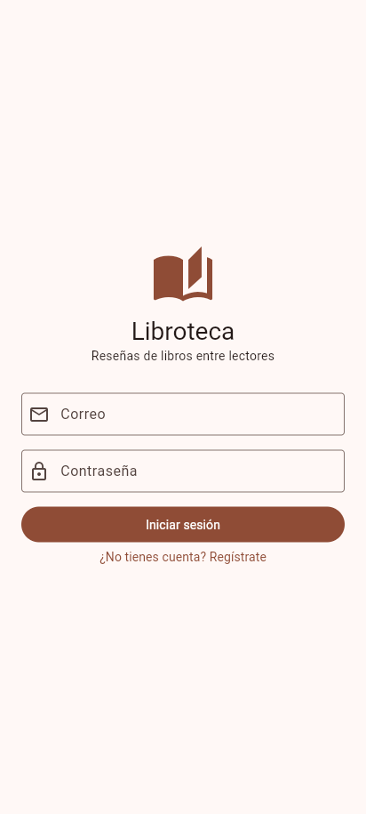
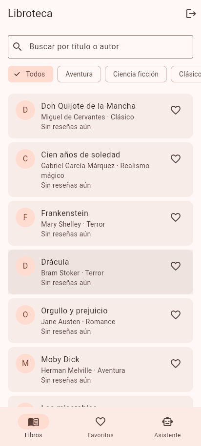
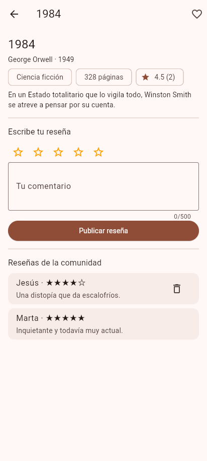
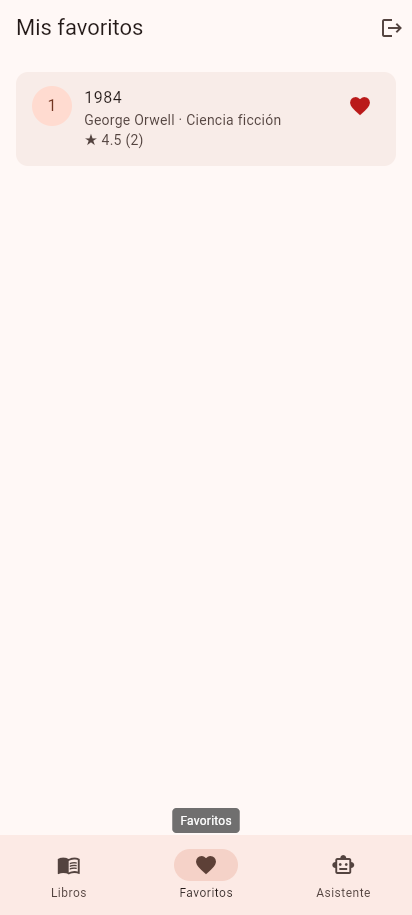
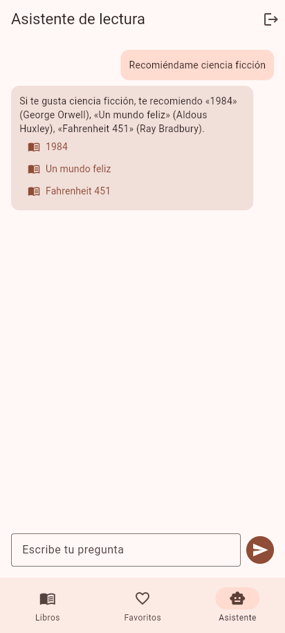

# Libroteca

App Flutter para lectores: explora un catálogo de 24 libros, guarda tus favoritos en el teléfono, escribe reseñas que ven todas las personas de la comunidad y pídele recomendaciones a un asistente de lectura.

## Capturas de pantalla

| Inicio de sesión | Catálogo | Reseñas colaborativas |
|---|---|---|
|  |  |  |

| Favoritos (locales) | Asistente de IA |
|---|---|
|  |  |

## Qué incluye

- [x] Registro, inicio y cierre de sesión con JWT propio; token en almacenamiento seguro
- [x] Catálogo (24 libros del backend) con estados de carga, vacío y error, búsqueda y filtro por género
- [x] Favoritos en Hive: sobreviven al cierre de la app
- [x] Reseñas (crear, ver, eliminar) protegidas por token; visibles para todas las personas
- [x] Asistente de lectura mediante el servidor propio, sin claves en la app
- [x] Estado compartido con GetX

## Cómo ejecutarla

Requisitos: Flutter estable, Node.js 20+ (sin instalar paquetes) y un emulador Android.

1. **Backend** (puerto 3000):

   ```bash
   cd backend
   node server.js
   ```

   Opcional: `cp .env.example .env` y completar `GEMINI_API_KEY` para que el asistente use el modelo de Google. Sin clave responde con reglas simples. Pruebas: `npm test`.

2. **App:**

   ```bash
   flutter pub get
   flutter run
   ```

3. **Direcciones por entorno.** Emulador Android: `http://10.0.2.2:3000` (por defecto). Dispositivo físico:
   `flutter run --dart-define=API_BASE_URL=http://<ip-de-tu-computador>:3000`.

Para probar: crea una cuenta desde la app (nombre, correo, contraseña de 6+ caracteres).

## APK

Se descarga de la sección **Releases** del repositorio. Lo genera GitHub Actions al subir una etiqueta `v*` (`.github/workflows/release-apk.yml`). Instálalo en un emulador con el backend encendido (`adb uninstall ec.libroteca.libroteca` antes si tenías la versión de depuración).

## Arquitectura

```text
screens/       pantallas (solo interfaz)
controllers/   estado con GetX (auth, libros, reseñas, asistente)
services/      llamadas HTTP (dio) y almacenamiento seguro del token
repositories/  datos locales (favoritos en Hive)
models/        Libro, Resena, Usuario, RespuestaIA
backend/       servidor Node: auth JWT, libros, reseñas, /asistente
```

Un dato viaja así: `CatalogoScreen` observa `LibrosController` → este llama a `LibrosService` → `ApiClient` (dio, añade el token y traduce errores a `ApiException`) → `GET /libros`. Ninguna pantalla hace HTTP.

## Decisión técnica propia

Escribí el backend en Node.js **sin dependencias externas** (JWT con `crypto`, contraseñas con scrypt, datos en un archivo JSON). Descarté Firebase y FastAPI para que quien evalúe arranque todo con un solo comando, sin cuentas. La contrapartida: un archivo JSON no escala; en producción iría una base de datos. El asistente vive en el mismo servidor, único lugar donde puede estar la clave de IA, y los fallos del proveedor (429, 502, 504) se traducen a mensajes legibles.

## Tecnologías

`get` (estado), `dio` (HTTP), `flutter_secure_storage` (token), `hive` / `hive_flutter` (favoritos), Node.js `http` y `crypto` (backend).

## Seguridad

- No hay claves en el repositorio; `.env` está en `.gitignore` (hay `.env.example` sin valores).
- El token se guarda con `flutter_secure_storage` y nunca se imprime; el servidor no registra cabeceras ni cuerpos.
- La clave de IA (opcional) solo se lee de la variable de entorno del backend.
- Las reseñas exigen token y solo su autor puede eliminarlas (403 si no).

## Créditos y licencias

Datos del catálogo (títulos, autores, años): datos factuales; las sinopsis son resúmenes propios. Paquetes: get, dio, flutter_secure_storage, hive (MIT / BSD / Apache-2.0). Íconos: Material Icons (Apache-2.0).
